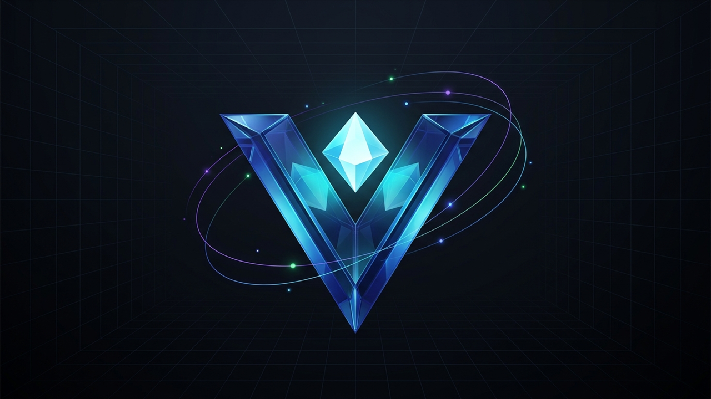

<div align="center">
  
  <h1>Velum Code</h1>
  <p><strong>Your coding agents. Local &amp; cloud. One studio.</strong></p>
  <p>A native Windows studio for <strong>Claude Code</strong>, <strong>Bonsai 2 (Local GPU)</strong>, <strong>OpenAI Codex</strong>, <strong>Google Antigravity</strong>, and <strong>Muse</strong>.<br />Created by <a href="https://github.com/velumix"><strong>Velumix</strong></a>.</p>
  <p>
    <a href="https://github.com/velumix/VelumCode/actions/workflows/windows.yml"></a>
    <a href="https://github.com/velumix/VelumCode/actions/workflows/android.yml"></a>
    <a href="https://github.com/velumix/VelumCode/releases"></a>
    
    
    
  </p>
  <p>
    <a href="#get-velumcode"><strong>Get VelumCode</strong></a> ·
    <a href="#why-i-built-it">The story</a> ·
    <a href="docs/swarm.md">Multi-Provider Swarm</a> ·
    <a href="docs/bonsai.md">Bonsai 2 Local GPU</a> ·
    <a href="docs/README.md">Documentation</a> ·
    <a href="https://github.com/velumix/VelumCode/issues">Feedback</a>
  </p>
</div>

<p align="center">
  
</p>

## Why I built it

I'm **[Velumix](https://github.com/velumix)**, and I built VelumCode because terminal coding agents deserved a real native desktop studio — something that stays alive in the Windows tray, notifies you when background turns finish, puts Git diffs and multi-agent tools beside every conversation, and connects local GPU models alongside frontier cloud CLIs without duplicating your workflow.

**Velum Code now orchestrates five first-class coding providers** (**Claude Code**, **Bonsai 2 Local GPU**, **OpenAI Codex**, **Google Antigravity**, and **Muse**) inside one interactive Tauri + React studio: rich syntax-highlighted conversations, clickable diff chips, multi-provider `/swarm` delegation, embedded Windows ConPTY terminals, scheduled bot teams, a Markdown vault synced with Obsidian, and mobile remote control over Tailscale or USB.

<p align="center">
  
</p>

## What's new & core studio features

| Capability | What you get |
| :-- | :-- |
| **Five native providers** | Run **Claude Code**, **Bonsai 2 (Local GPU)**, **OpenAI Codex**, **Google Antigravity**, and **Muse** in parallel tabs with separate sessions and drafts. [Provider guide](#providers). |
| **Multi-provider `/swarm`** | Delegate sub-tasks (`delegate_task`) or fan out 2–6 concurrent workers (`run_swarm`) across `bonsai-fast` (`:8090`), `bonsai` (`:8080`), `claude`, `codex`, `antigravity`, `muse`, and enabled Velum Bots directly from the composer **Swarm** picker. [Swarm guide](docs/swarm.md). |
| **Local GPU intelligence (`Bonsai 2`)** | Dual-server GPU architecture pairing `Bonsai-2-27B` (`:8080` reasoning/vision) with `Bonsai-2-4B` (`:8090` ~150 tok/s swarm worker) and a 15-tool local MCP server (`:8081`). [Bonsai guide](docs/bonsai.md). |
| **Interactive studio chat** | Theme-adaptive syntax highlighting, code actions (`Wrap`, `Insert`, `Run`, `Copy`), GitHub callouts, clickable file chips opening Split Diff, photo attachments with lightbox zoom, inline prompt **Edit & Resend**, **Retry**, and **Quick Follow-ups**. [Conversation guide](docs/conversation-experience.md). |
| **Actionable activity cards** | Even while collapsed, tool groups surface live thought previews, category badges, Swarm worker counts, and `+add / -del` touched-file pills; expanded Swarm calls render live **Swarm Worker Cards**. [Tools guide](docs/agent-tools.md). |
| **Composer control pickers** | Toggle workspace **Tools** (`file_delete`, `vault_search`, `browser`, `native_screenshot`, `native_control`, `swarm`), **Skills** (up to 8 per turn), and **Swarm** rosters right from the composer toolbar. |
| **Split Studio & GitHub Hub** | Toggle **Stream / Split / Dashboard** views to inspect unified & side-by-side intra-line diffs, live tool logs, token telemetry, Kanban cards, PRs, and Issues without leaving the turn. |
| **Bot teams & Kanban cron jobs** | Named bots with profile images, `soul.md`, `agent.md`, private Markdown vaults, and scheduled Kanban automation with automatic teammate handoffs and pause/stop guardrails. [Bots guide](docs/bots.md). |
| **Local Markdown Memory Vault** | Obsidian-compatible project and shared Markdown notes (`Documents/Velum Code/Memory`) with review queue, pinning, byte budgets (`1 KB` / `3 KB` / `8 KB`), and correction lessons. [Memory guide](docs/memory.md). |
| **Close to tray & Notifications** | Closing the window hides Velum Code to the Windows system tray while active agents, schedules, and phone connections keep running and notify on completion. |
| **Take it on your phone** | Native [Android APK](docs/android.md) with QR scanner + responsive mobile web app over Tailscale Serve HTTPS (`8443`) or USB cable, sharing live transcripts, queues, boards, and bots. [Remote access](docs/remote-access.md). |

<table>
  <tr>
    <td width="50%"><a href="docs/images/musecode-conversation.png"></a></td>
    <td width="50%"><a href="docs/images/musecode-commands.png"></a></td>
  </tr>
  <tr>
    <td align="center"><strong>Syntax-highlighted turns, file pills &amp; diff cards.</strong></td>
    <td align="center"><strong>Command palette, slash workflows &amp; quick controls.</strong></td>
  </tr>
</table>

## Get VelumCode

**Requirements**: Windows x64 and at least one supported CLI (or local **Bonsai 2** setup).

### Option 1 — Signed GitHub Release (recommended)

1. Download the latest `Velum.Code_<version>_x64-setup.exe` from [**GitHub Releases**](https://github.com/velumix/VelumCode/releases).
2. Run the installer and launch **Velum Code**.
3. Installed releases automatically check GitHub on launch during the opening animation, verify installer signatures, download new releases, install silently, and reopen with your open tabs and drafts preserved. See [App updates](docs/updates.md).

### Option 2 — Windows CI preview artifact

1. Open [Windows CI](https://github.com/velumix/VelumCode/actions/workflows/windows.yml) and pick the latest green run.
2. Download **VelumCode-windows-x64** from **Artifacts**, extract the ZIP, and run `Velum Code_<version>_x64-setup.exe`.

Prefer building locally? Jump to [Build from source](#build-from-source).

## Providers

| Provider | CLI command | Account & setup |
| :-- | :-- | :-- |
| **Claude Code** | `claude` | Install `@anthropic-ai/claude-code`, choose **Claude**, and sign in via browser subscription (`claude auth login`) or console API mode. |
| **Bonsai 2 · Local GPU** | `bonsai` | Runs 100% locally via `Bonsai-2-27B` (`:8080`) + `Bonsai-2-4B` (`:8090` fast worker) with vision, `<think>` streaming, and native swarm delegation. See [Bonsai guide](docs/bonsai.md). |
| **OpenAI Codex · ChatGPT** | `codex` | [Install Codex CLI](https://developers.openai.com/codex/cli/) and sign in with your ChatGPT or API account. |
| **Google Antigravity** | `agy` | [Install Antigravity CLI](https://antigravity.google/docs/getting-started?tab=cli), pick Antigravity, and click **Sign in**. |
| **Muse** | `muse` | Uses your installed Muse CLI session and account. |

Switching providers opens a dedicated conversation in the same workspace while preserving existing tabs, terminals, and drafts. Selectors load each provider's model catalog and reasoning levels (**Model** + **Reasoning**) and remember your preferences per provider.

<p align="center"></p>

Agent view supports live streaming tool cards, task checklists, interactive approval/question prompts, and an optional **YOLO** toggle beside the composer (respecting each provider's sandbox rules). Every tab also includes an embedded **Terminal** view over Windows ConPTY for direct interactive CLI usage.

## Your own bot team & Swarm orchestration

Open **Bots → New bot** to give an assistant a custom avatar, specialty role, preferred provider/model, **`soul.md`**, **`agent.md`**, default skills, and a private Markdown memory vault (`Documents/Velum Code/Memory/bots/<bot-id>/`). Assign bots to Kanban cards to create cron schedules with automatic teammate handoffs and per-run caps. [Read the bots guide](docs/bots.md).

Use the **Swarm** picker beside the composer (or type `/swarm` or `/delegate`) to let any coordinator model delegate focused slices or run parallel Council reviews across your installed providers and bots. [Read the swarm guide](docs/swarm.md).

<p align="center"></p>

## Phone companion, Memory Vault, Kanban, Plugins & Skills

- **Phone companion**: Connect over private Tailscale Serve HTTPS (`8443`) or USB cable using the [Android APK](docs/android.md) or mobile browser. Approve pairings from desktop and switch smoothly between **control** and **view-only** permissions. [Remote access guide](docs/remote-access.md).
- **Markdown Memory Vault**: Stored in `Documents/Velum Code/Memory` as standard YAML+Markdown files compatible with Obsidian, enforcing strict context byte limits (`1 KB` / `3 KB` / `8 KB`) and a user-reviewed suggestion workflow. [Memory guide](docs/memory.md).
- **Kanban workstation**: Up to 300 active cards per workspace across **Backlog**, **In progress**, **Review**, and **Done**, with due dates, dependency blockers, Trash restore, and GitHub issue bridging. [Kanban guide](docs/kanban.md).
- **Sandboxed Plugins & Skills**: Build custom tools in TypeScript via `packages/plugin-sdk` ([Plugins guide](docs/plugins.md)) or browse/install GitHub `SKILL.md` instruction packs per chat or per bot ([Skills guide](docs/skills.md)).

<table>
  <tr>
    <td width="50%"><a href="docs/images/memory-desktop.png"></a></td>
    <td width="50%"><a href="docs/images/kanban-desktop.png"></a></td>
  </tr>
  <tr>
    <td align="center"><strong>Markdown Memory Vault (Obsidian-ready).</strong></td>
    <td align="center"><strong>Workspace Kanban with bot scheduling.</strong></td>
  </tr>
</table>

## Shortcuts

| Shortcut | Action |
| :-- | :-- |
| `Ctrl+K` | Open command palette |
| `Ctrl+,` | Open settings (themes, Crystal Glass, typography, tools) |
| `Ctrl+T` | Start a new conversation tab |
| `Ctrl+Tab` / `Ctrl+Shift+Tab` | Switch conversation tabs |
| `Ctrl+1` … `Ctrl+9` | Jump to tab |
| `Ctrl+L` | Focus composer input |
| `Enter` / `Shift+Enter` | Send / insert newline |
| `Ctrl+F` | Find in terminal |
| `Ctrl+=` / `Ctrl+-` / `Ctrl+0` | Zoom terminal in / out / reset |

## Build from source

Prerequisites: Node.js 24 (`.node-version`), Rust toolchain (`rust-toolchain.toml`), Windows MSVC build tools, and at least one supported provider CLI. See [`.node-version`](.node-version) and [`rust-toolchain.toml`](rust-toolchain.toml).

```powershell
git clone https://github.com/velumix/VelumCode.git
cd VelumCode
npm.cmd ci
npm.cmd run tauri dev
```

Build the standalone desktop executable (`custom-protocol` embedded bundle) or full NSIS installer:

```powershell
# Standalone preview installer (no signing secret required)
npx.cmd tauri build --bundles nsis --config src-tauri/tauri.preview.conf.json

# Or release binary + local install helper
powershell -NoProfile -ExecutionPolicy Bypass -File scripts/install.ps1 -Build
```

> [!IMPORTANT]
> Always use `npx.cmd tauri build` (rather than plain `cargo build --release`) when producing standalone executables so `tauri/custom-protocol` embeds `dist/` instead of looking for `localhost:1420`.

Architecture: **Tauri 2 + Rust** backend, **React 19 + TypeScript** frontend, **xterm.js + Windows ConPTY** embedded terminals, **axum** host tool & remote server, **SQLite** automation storage, and **Markdown + YAML** vaults. See [Development notes](docs/development.md) and [Brand notes](docs/brand.md).

## Where it stands

Automated CI checks verify TypeScript/Vite compilation, `220+` Playwright UI & WCAG 2.1 AA accessibility specs, `300+` Rust unit tests (`cargo test --lib`), `cargo fmt`, `cargo clippy -- -D warnings`, plugin SDK guards, legal/documentation link integrity, Windows installer bundling, and Android APK builds. Every push to `main` automatically tags and publishes a signed release via [Auto-release on main](docs/updates.md).

Open areas still evolving:
- **Searchable archive of closed tabs** (open tabs recover across restarts; closed-tab history lookup is planned).
- **Rich phone controls parity** (managing bots, queues, and Kanban works on phone; desktop hosts plugin/skill installation and Bonsai GPU runtime management).

## Documentation, privacy and licensing

Start with the [documentation index](docs/README.md), [getting started](docs/getting-started.md), [multi-provider swarm](docs/swarm.md), [Bonsai 2 guide](docs/bonsai.md), [troubleshooting](docs/support.md), and [data controls](docs/data-controls.md).
The [terms](TERMS.md) and [privacy notice](PRIVACY.md) remain drafts pending publisher review; see [legal status](LEGAL.md) and the [security policy](SECURITY.md). Prompts, selected context, and files inspectable by an enabled provider CLI go only to the chosen provider (or stay 100% on your GPU when using Bonsai 2).

---

<p align="center">
  Built by <a href="https://github.com/velumix"><strong>Velumix</strong></a>.<br />
  <sub>Your coding agents. Local &amp; cloud. One studio.</sub>
</p>
